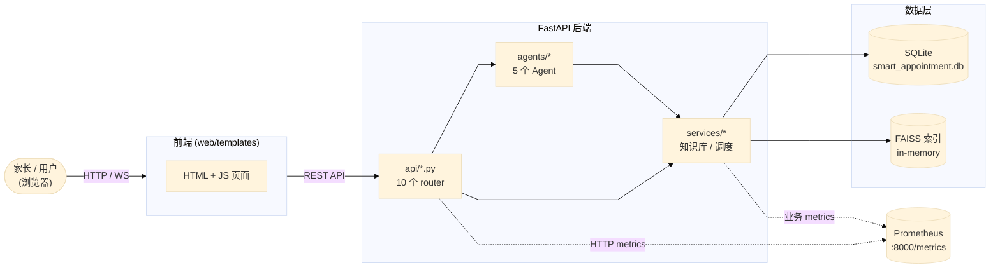
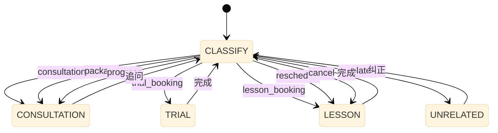
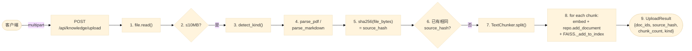
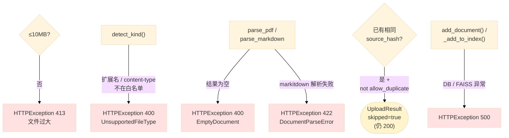
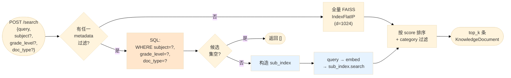
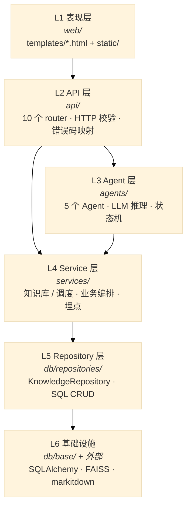
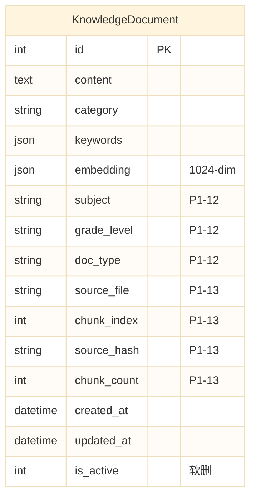
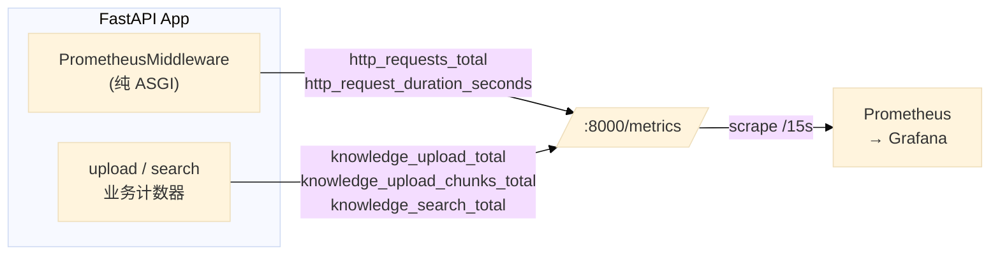

# Smart Tutor Appointment AI Agent — 架构文档

> 家教智能预约平台的多 Agent 系统架构、数据流与关键设计决策。
> 配套代码版本:v1.0 (P1-13: PDF / Markdown 上传) + 可观测性 (Prometheus metrics)

> 💡 **图太小看不清?** GitHub 渲染时按 mermaid 图右下角的 `+` 按钮放大;VSCode 用 `Ctrl+Shift+P → Mermaid: Zoom`;也可在 [mermaid.live](https://mermaid.live) 粘贴源码看大图。

---

## 1. 系统总览

---

## 2. 多 Agent 路由状态机

主入口是 `TaskClassificationAgent`(`agents/task_classification_agent.py`),它用 `StateEnum` 维护一个共享会话状态机。LLM 一次推理把用户输入分成 8 类,然后路由到对应 Agent。

**路由实现**:`agents/task_classification/agent_router.py` 里的 `AgentRouter.route(intent, user_input)`。

| Intent | 路由到 | 关键能力 |
|---|---|---|
| `CONSULTATION` | `ConsultantAgent` | 知识库 RAG 检索 + LLM 生成 |
| `TRIAL_BOOKING` | `TrialAgent` | 老师匹配 + 时段推荐 + 预约落地 |
| `LESSON_*` | `LessonAgent` | 套餐验证 + 课时预约/调课/退课 |
| `UNRELATED` | `UnrelatedHandler` | 礼貌拒答并引导回主流程 |

---

## 3. 知识库上传管道 (P1-13)

`POST /api/knowledge/upload` 走 SHA256 去重 → PDF/Markdown 解析 → 文本分块 → 嵌入 → 入库 → FAISS 增量。

### 3.1 主流程(成功路径)

### 3.2 错误 / 跳过分支

### 关键设计点

| 决策                             | 原因                                                                           |
| ------------------------------ | ---------------------------------------------------------------------------- |
| **SHA256 去重**(`source_hash` 列) | 同一文件二次上传秒级跳过,避免重复嵌入算力浪费                                                      |
| **lazy import markitdown**     | `parse_pdf()` 函数体内 `from markitdown import MarkItDown`,模块顶部 import 失败不阻塞服务启动 |
| **markitdown[pdf] 直接 PyPI 依赖** | 不 sys.path 注入 RAG-MCP 源码,避免跨项目耦合                                             |
| **中文友好 separators**            | `["\n\n", "\n", "。", "；", " ", ""]` — 避免英文-only 分块器把整段中文当一块                  |
| **frozen dataclass DTO**       | `UploadRequest` / `TextChunk` / `ParsedDocument` 创建后不可变,上传流程中途不会被误改          |

---

## 4. 知识库搜索过滤范式 (P1-12)

**filter-then-vector**:先用 SQL 硬约束锁死候选集,再在子集上跑 FAISS。避免"高一数学"和"高三数学"向量近邻污染召回。

### 为什么不用纯向量搜

业务硬约束(学科 / 年级)必须 100% 准确。纯向量搜召回"高一数学"是合法的(语义近),但家长明确要"高三"就是召回失败。filter-then-vector 把这个责任给 SQL 把关,FAISS 只负责相关性排序。

---

## 5. 分层架构

### 各层职责

| 层 | 职责 | **不**做什么 |
|---|---|---|
| API | HTTP 路由、参数校验、错误码映射 | 业务逻辑、SQL |
| Agent | 多 Agent 编排、LLM 推理、对话状态 | 直连 DB |
| Service | 业务规则、跨模块编排、可观测埋点 | HTTP 协议 |
| Repository | SQL CRUD、ORM 映射、过滤下推 | 业务规则、LLM |
| Base | session 管理、interface 定义、schema 迁移 | 业务语义 |

---

## 6. 数据模型 — `KnowledgeDocument` (P1-13 后)

### P1-13 新增 4 列说明

| 列             | 类型           | 含义                                     | 老数据  |
| ------------- | ------------ | -------------------------------------- | ---- |
| `source_file` | VARCHAR NULL | 原始上传文件名(e.g. `12_week_math.pdf`)       | NULL |
| `chunk_index` | INTEGER NULL | 文件内 0-based 位置                         | NULL |
| `source_hash` | VARCHAR NULL | SHA256(file_bytes) hex(64 chars) — 去重键 | NULL |
| `chunk_count` | INTEGER NULL | 文件总块数,所有 chunk 行相同                     | NULL |

**Schema 迁移**:`db/base/schema_migrator.py` 用幂等 `ALTER TABLE ... ADD COLUMN`,**不做 backfill** — 老数据无源文件信息,NULL 是正确值。

---

## 7. 可观测性 (Prometheus Metrics)

### 关键 metric 列表

| Metric                          | 类型        | Labels                               | 用途                |
| ------------------------------- | --------- | ------------------------------------ | ----------------- |
| `http_requests_total`           | Counter   | method, path, status                 | QPS / 错误率 / 路由热度  |
| `http_request_duration_seconds` | Histogram | method, path                         | P50/P95/P99 延迟    |
| `knowledge_upload_total`        | Counter   | outcome, kind                        | 上传成功率 / 去重率       |
| `knowledge_upload_chunks_total` | Counter   | kind                                 | 入库 chunk 数(去重不计入) |
| `knowledge_upload_bytes_total`  | Counter   | kind                                 | 上传字节流量            |
| `knowledge_search_total`        | Counter   | has_meta_filter, result_count_bucket | 搜索调用频次 + 召回分布     |

### path label 的 high-cardinality 防护

中间件用 **`route.path` template**(e.g. `/api/knowledge/{knowledge_id}`)而非 `request.url.path`。否则 `/items/1` `/items/2` ... 都会成独立 label,Prometheus 会被炸掉。

### /metrics 端点本身不打点

`PrometheusMiddleware` 第一行就 `if path == "/metrics": return`,避免 Prometheus 抓取 → 产生 metric → 抓取 → 产生 ... 的无限循环。

---

## 8. 已知问题与改进路径

| 问题 | 缓解措施 | 改进方向 |
|---|---|---|
| `_build_vector_index` 在 DB 含异 dim 时崩溃 | 防御性 filter(已实现) | 启动时 schema 校验 |
| `tests/conftest.py` 强制 `:memory:` 隔离 prod DB | 已加 `TEST_USE_PROD_DB=1` 可关闭 | CI 上跑 schema 校验 + 真实路径 |
| LangChain 0.x ↔ 1.x 版本漂移 | `requirements.txt` pin `<1.0` | `pyproject.toml` + `uv.lock` |
| 上传同步阻塞(30s+) | 10MB 上限锁住 | 后台任务队列 + WebSocket 进度推送 |
| SQLite 单写串行 | 当前流量下够用 | Postgres + connection pool |
| API 无鉴权(任何人能上传) | dev 默认关闭 | 计划中的 `ADMIN_API_TOKEN` Bearer |

---

## 9. 关键文件索引

| 关注点 | 文件 |
|---|---|
| 上传入口 | `api/knowledge.py` — `upload_knowledge()` |
| 上传编排 | `services/knowledge_service.py` — `add_uploaded_document()` |
| 解析器 | `services/document_parser.py` |
| 分块器 | `services/text_chunker.py` |
| Schema 迁移 | `db/base/schema_migrator.py` |
| Repository | `db/repositories/knowledge_repository.py` |
| Agent 路由 | `agents/task_classification/agent_router.py` |
| 状态枚举 | `config/constants.py` — `IntentType` / `StateEnum` |
| Metrics 中间件 | `observability/middleware.py` |
| 测试隔离 | `tests/conftest.py` |

---

**最近一次更新**:2026-09-03 — 加入 P1-13 上传管道、可观测性、过滤范式图。