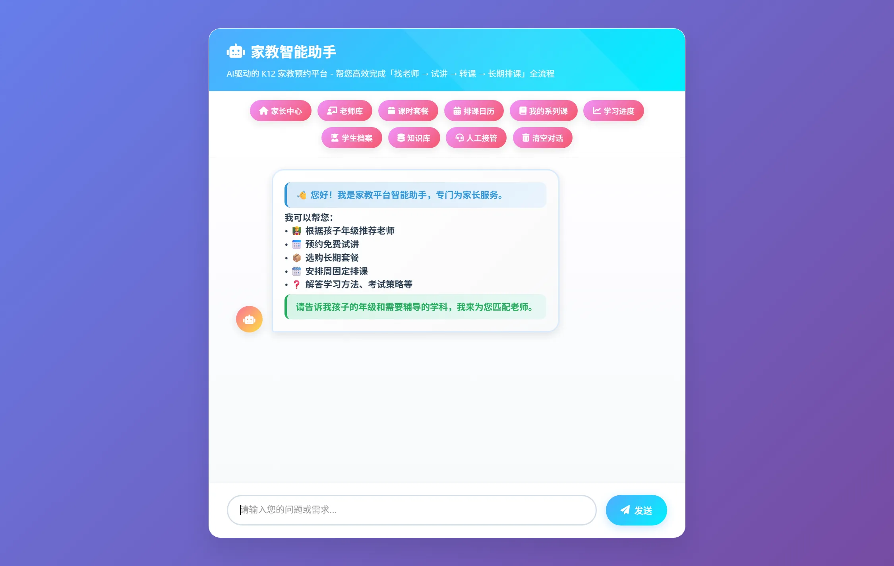
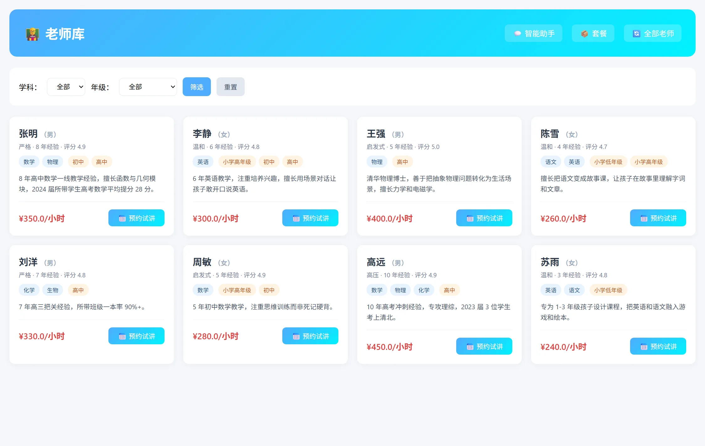

<div align="center">

# Smart Tutor Appointment AI Agent

**面向 K12 一对一家教的多 Agent 智能教务前台 —— 把「找老师 → 试讲 → 转课 → 长期排课」交给 AI**




</div>

---

## 这是什么

家教机构的教务前台每天要处理排班、咨询、报价、调课、续费这些碎事：信息散落在微信和表格里，排课容易撞车，服务质量高度依赖前台个人的经验。

本项目把这条链路做成一个可运行的多 Agent 系统：家长用自然语言提问，系统先识别意图，再把任务分发给对应的专业 Agent，完成老师匹配、试讲预约与转化、正式课/系列课排课与调课退课、RAG 知识问答、学习进度与流失预警，并在 AI 处理不了时把会话交给人工。

技术栈 FastAPI + LangChain/LangGraph + SQLAlchemy(SQLite) + FAISS，五层单向依赖架构，28 张表 / 76 条路由 / 10 类意图 / 1645 条测试全绿。

## 核心能力

**对话与编排**

- **意图识别三层漏斗**：规则层（人工接管关键词、档期白名单、匿名身份约束）→ 状态机旁路（续轮态跳过分类器直接分派）→ LLM few-shot 分类（10 类意图）；先便宜规则、再状态、最后才调模型，兼顾延迟、成本与准确率
- **多 Agent 分工**：1 个主控 + 4 个业务 Agent（咨询 / 试讲 / 正式课 / 学员行为），消息格式统一为 `[THOUGHT]/[REPLY]` 流式标记，主控与下游之间通过 `unrelated_callback` 双向回流
- **两种编排实现**：自研五层状态机（默认，稳定）与 LangGraph 图编排（`ORCHESTRATOR=graph` 启用，含 `SqliteSaver` 持久化与 `interrupt()` 人工接管挂起/恢复）；两条链路有 25 轮双跑对拍脚本
- **Agentic 工具循环**：`POST /agentic/chat` 演示「LLM 自行决定查档期 → 调创建试讲工具 → 回填结果」的完整工具调用闭环

**业务闭环**

- **试讲 → 转正式课漏斗**：多轮补齐需求 → 创建试讲 → 课后 1-5 星反馈 → 套餐推荐 → 一键转正式课 / 系列课
- **系列课与冲突检测**：单次试讲 / 单次正式课 / 周固定系列课 / 补课；按 `weekly_pattern` 展开，含时间冲突预检、调课（家长发起 → 老师确认后生效）、退课（审计保留）
- **老师匹配**：综合学科、年级、风格、预算、评分打分，支持硬过滤与软匹配双模式
- **续费与流失预警**：`RenewalDetector`（剩余课时 ≤ 3 或有效期 < 14 天）触发提醒；`ChurnPredictor` 按活跃度评估流失风险
- **人工接管（Human-in-the-loop）**：主动关键词 + 被动「反复踢回」阈值双通道触发；触发时快照会话 transcript 落库，客服可 claim / reply / 查看消息，家长端轮询取回复
- **身份与会话隔离**：cookie 匿名身份 + session 归属校验，未验证身份只开放咨询与公开老师匹配，预约/退课/进度等写操作必须归属本人

**检索**

- **混合检索 Hybrid RAG**：Dense(FAISS) + BM25(jieba 中文分词) 双路召回 → RRF 融合 → 本地 ONNX cross-encoder 精排（`bge-reranker-base` 中文优先）；dense 路依赖外部 embedding API，失败时降级为 BM25-only 而不是丢掉整轮召回，两路皆空才返回空召回；检索前对口语化 query 做多查询变换（默认规则档、零 LLM，原串恒排第 0 位），各路召回结果一起进 RRF；精排后按内容去重（相关性阈值默认关闭，开启需按模型量纲校准），命中结果在 prompt 中带 `[资料N|分类]` 来源编号；精排不可用时自动回退 RRF 结果（该路径不应用阈值）
- **分层记忆**：会话短期记忆 + 长期记忆 Top-5 相关召回（`0.6*相似度 + 0.3*时间衰减 + 0.1*重要度`）+ 画像摘要共存；上下文窗口占用超阈值触发滚动摘要并持久化
- **AutoDream 后台回放**：会话数达到阈值后异步回放近期对话，增量抽取知识点，向量去重合并、冲突降权，带任务锁 + 检查点 + 变更日志保证幂等

**工程与质量**

- **EDD 评估与发布门禁**：67 条冻结用例（routing 12 / rag 24 / slot 10 / tool 7 / handoff 6 / safety 红队 8）与 10 项门禁阈值（准确率、Recall@3、P95 延迟、Token 成本、最大步数），任一不达标即 `exit 1` 拦截发布
- **可观测性**：JSON 结构化日志 + `X-Request-ID` 中间件 + 零依赖 span 链路追踪（嵌套 / 耗时 / 异常标记），埋点在分类、检索、工具调用三处，另暴露 Prometheus `/metrics`
- **组件工厂**：LLM / Embedding / Splitter / VectorStore / Reranker / Evaluator 六类组件通过 `config/components.yaml` 声明式切换实现，缺失即回落默认，不重构现有调用路径

## 界面预览



| 页面 | 说明 |
| --- | --- |
| `/` | 家长端统一对话入口（咨询 / 试讲 / 排课 / 调课 / 退课） |
| `/teachers` | 老师库，按学科 / 年级筛选并预约试讲 |
| `/packages` | 课时套餐与购买 |
| `/schedule-calendar` | 排课日历视图 |
| `/lesson-series` | 周固定系列课 |
| `/progress-dashboard` | 学员学习进度看板 |
| `/student-profile` | 学生档案（薄弱点、偏好、活跃度、流失风险） |
| `/parent-center` | 家长中心（续费提醒、流失预警、推荐汇总） |
| `/console/login` | 机构后台登录（`admin` / `support` / `academic` 三种角色） |
| `/console/human-handoff` | 人工接管队列（客服 claim / 回复；需 `support` 或 `admin`） |
| `/console/knowledge` | 学科知识库管理（需 `academic` 或 `admin`） |
| `/console/user_behavior_analysis` | 学员行为分析看板（需 `academic` 或 `admin`） |
| `/teacher/login` · `/teacher` | 老师端：本老师待办、确认 / 拒绝档期与调课请求（需老师账号） |

## 系统架构

严格的五层单向依赖，下层不得反向调用上层：

```text
Web & Application   app.py, web/          页面、路由入口、启动与调度
        ↓
API                 api/                  76 条路由、请求编排、统一响应封装
        ↓
Agents              agents/               意图识别、多 Agent 流程、LangGraph 图
        ↓
Services            services/             推荐、排课、检索、记忆、人工接管
        ↓
DB                  db/                   28 张表的 SQLAlchemy 模型 + Repository
```

| Agent | 职责 |
| --- | --- |
| **Task Classification Agent** | 主控调度：10 类意图识别、状态机流转、路由分派、unrelated 回流与踢回计数 |
| **Consultation Agent** | RAG 知识问答：知识库优先，命中不足时降级兜底，约束模型不自由发挥 |
| **Trial Agent** | 试讲转化漏斗：多轮需求补全 → 创建试讲 → 反馈收集 → 套餐推荐 → 转正式课 |
| **Lesson Agent** | 正式课 / 系列课生命周期：排课、冲突预检、调课、退课、进度记录 |
| **User Behavior Agent** | 行为与偏好分析，配套 `RenewalDetector` / `ChurnPredictor` 子模块 |

模型温度按角色分层（主控 0 → 咨询 0.3 → 行为 0.7），全链路 `async generator` 流式输出。

## 快速开始

环境要求：Python 3.10+，一个 OpenAI 兼容格式的 LLM API Key（DeepSeek / Qwen / 智谱 / OpenAI 等）。

```bash
# 1. 依赖
python -m venv .venv
source .venv/bin/activate        # Windows: .\.venv\Scripts\Activate.ps1
pip install -r requirements.txt

# 2. 配置（复制模板后填入自己的 Key / Base URL）
cp .env.example .env             # Windows: copy .env.example .env

# 3. 启动
python -m uvicorn app:app --host 127.0.0.1 --port 8000
```

打开 http://127.0.0.1:8000 使用家长端对话入口，http://127.0.0.1:8000/docs 查看接口文档。

`.env` 关键配置（完整项见 `.env.example`）：

```env
MODEL_PROVIDER=deepseek
LLM_API_KEY=your_llm_api_key
LLM_BASE_URL=https://your-openai-compatible-endpoint/v1
LLM_MODEL=your_chat_model_name

# 注意：DeepSeek 没有通用 embedding API，EMBEDDING_PROVIDER 只能填
# openai / qwen / zhipu / doubao / openai-compatible（填 deepseek 会直接报错降级）
EMBEDDING_PROVIDER=qwen
EMBEDDING_API_KEY=your_embedding_api_key
EMBEDDING_BASE_URL=https://your-embedding-endpoint
EMBEDDING_MODEL=your_embedding_model_name

DATABASE_URL=sqlite:///./data/smart_appointment.db

RETRIEVAL_MODE=hybrid    # dense 单路 / hybrid 双路+RRF+精排（默认 hybrid）
RERANK_ENABLED=true
# RAG_MIN_RERANK_SCORE=0.0 # 精排相关性阈值，默认关闭（不设阈值，不过滤）；只在精排真的跑过时生效。
                          # 开启需按模型量纲校准：bge 的 logit 随 query 口语化程度整体下移，
                          # 0.0 不是中性分界（实测会把 recall@3 从 0.9167 打到 0.5000）。
RERANK_MAX_LENGTH=512    # 精排 tokenizer 截断长度（默认 512），中文 ~1 字 ≈ 1 token
QUERY_TRANSFORM=rule     # off / rule（默认，零 LLM）/ llm；检索前把口语化 query 扩成多查询召回
QUERY_TRANSFORM_TIMEOUT=3.0     # llm 档超时秒数；超时/异常一律回退 rule 结果
QUERY_TRANSFORM_MAX_VARIANTS=3  # 变体数上限（含原始 query，原串恒排第 0 位）
CHUNK_SIZE=500           # 分块大小（默认 500），须与 components.yaml 的 splitter 一致
CHUNK_OVERLAP=50         # 分块重叠（默认 50）
HANDOFF_THRESHOLD=3      # 连续踢回多少次自动转人工
ORCHESTRATOR=legacy      # legacy 自研状态机 / graph LangGraph 编排
```

### 检索前 query 变换（多查询召回）

用户口语化 / 指代不清的 query 在检索前先变换成 1~3 条检索串，各自召回后按 RRF 融合
（`services/query_transform.py` + `HybridRetriever.search_multi` / `KnowledgeService.search_multi`）。
**原始 query 永远排第 0 位且必须被检索** —— 变换只增量提高召回，不降低。

| 档位 | 行为 |
| --- | --- |
| `off` | 不变换，只检索原始 query |
| `rule`（默认） | 零 LLM 成本两条规则：术语归一（试听/试课→试讲、多少钱→收费标准 价格、1对1→一对一…）+ 指代补全（命中「这个/那个/怎么样」且上下文能抽出「年级 + 学科」时补成 `年级学科：query`，抽不到就不产） |
| `llm` | 额外调一次小 LLM（温度 0）产最多 2 条改写，与 rule 变体合并去重；超时（默认 3.0s）/ 异常 / 解析失败一律回退 rule 结果 |

`services/query_transform.py` 全程不抛异常：任何档位下返回值都非空、`[0]` 恒为原串、无重复、不超上限。

可选：`python scripts/download_reranker.py` 下载本地精排模型到 `cache/`（`bge-reranker-base`，约 279MB，走 hf-mirror）；不下载则精排自动回退 RRF。

### 试一下

```bash
# 端到端对话（需先启动服务）：咨询 → 推荐老师 → 试讲 → 反馈 → 转正式课
python scripts/demo_e2e.py http://127.0.0.1:8000

# 其余演示脚本均使用临时数据库，不污染生产数据
python scripts/demo_human_handoff.py             # 人工接管：关键词/阈值触发、transcript、claim/reply
python scripts/demo_langgraph_migrate.py         # LangGraph 图编排与对拍
python scripts/demo_observability_logs_traces.py # 结构化日志 / X-Request-ID / span 追踪
python scripts/demo_component_factory.py         # 六类组件声明式切换
python scripts/demo_query_transform.py           # query 变换：off / rule / llm 三档变体与召回差异
```

## 测试与评估

```bash
pytest tests/ -q                     # 1645 passed（2026-10-19 实测）
python -m eval.runner                # EDD 冻结用例 + 发布门禁
```

| 指标 | 实测值 |
| --- | --- |
| 单元 / 集成测试 | 1645 passed（83 个测试文件） |
| 冻结评估用例 | 67 条（routing 12 / rag 24 / slot 10 / tool 7 / handoff 6 / safety 8） |
| 发布门禁 | 10 项阈值全过（`eval/gates.py` 读 `config/evals.yaml`；`--only` 子集模式输出 PARTIAL 且只校验已跑类别） |
| 数据表 / API 路由 / 意图类别 | 28 / 76 / 10 |

## 项目结构

```text
├── agents/          # 主控 + 4 业务 Agent + LangGraph 图 + Agentic 工具循环
├── api/             # API 编排层（16 个 router + core 响应封装）
├── services/        # 业务逻辑：推荐 / 排课 / 知识库 / 混合检索 / query 变换 / 记忆 / 人工接管
├── db/              # SQLAlchemy 模型 + Repository（28 张表）
├── observability/   # 结构化日志、X-Request-ID、span 追踪、Prometheus 指标
├── eval/            # EDD 评估器、冻结用例、发布门禁
├── config/          # 设置、模型 Provider 工厂、时间语义、组件工厂、门禁阈值
├── web/             # Web 页面与模板（16 个页面）
├── scripts/         # 演示、重建 embedding、下载精排模型等工具脚本
├── tests/           # 1645 条测试
├── app.py           # 应用入口（路由注册、初始化、调度器）
└── requirements.txt
```

## 文档

- 业务模型与数据流：[`docs/TUTOR_DESIGN.md`](docs/TUTOR_DESIGN.md)
- 架构与模块地图：[`docs/ARCHITECTURE_MAP.md`](docs/ARCHITECTURE_MAP.md)
- Agent 流程时序图：[`docs/AGENT_FLOW_DIAGRAMS.md`](docs/AGENT_FLOW_DIAGRAMS.md)
- 数据字典：[`docs/DATA_DICTIONARY.md`](docs/DATA_DICTIONARY.md)
- 完整版 README（逐 Agent 细述）：[`docs/README_FULL.md`](docs/README_FULL.md)

## License

[MIT](./LICENSE)
