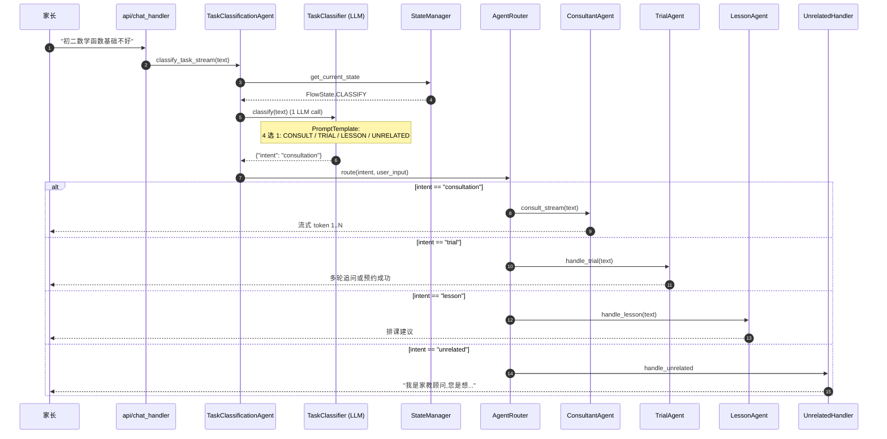
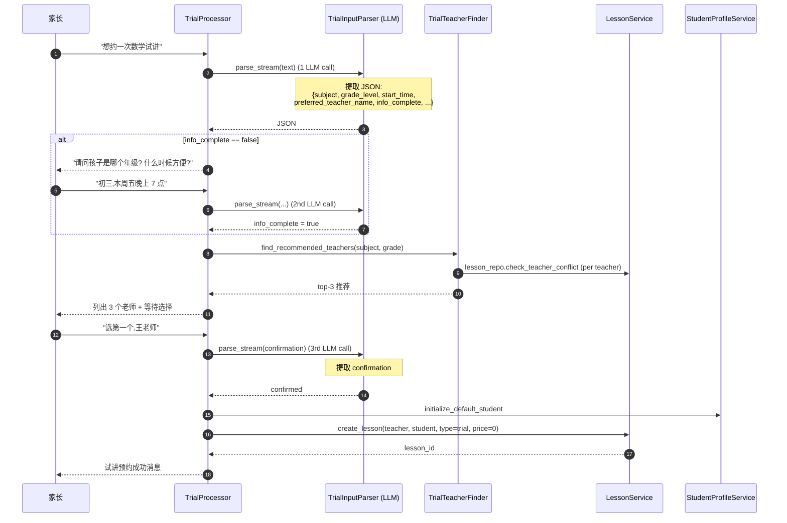
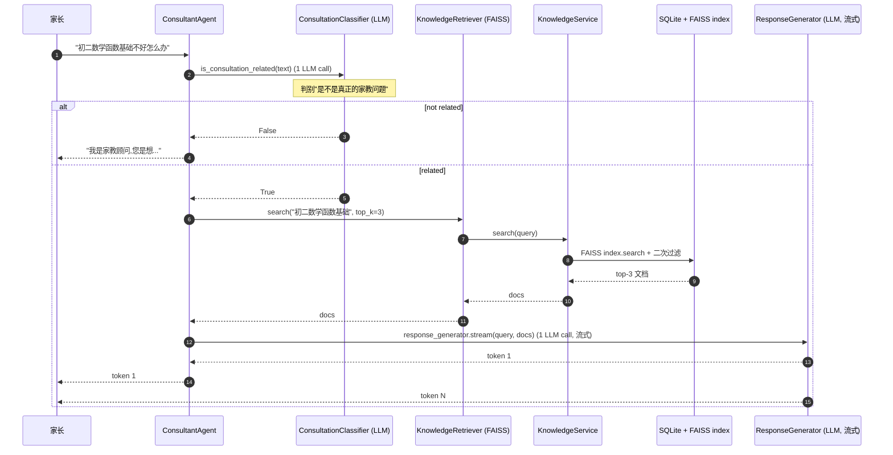
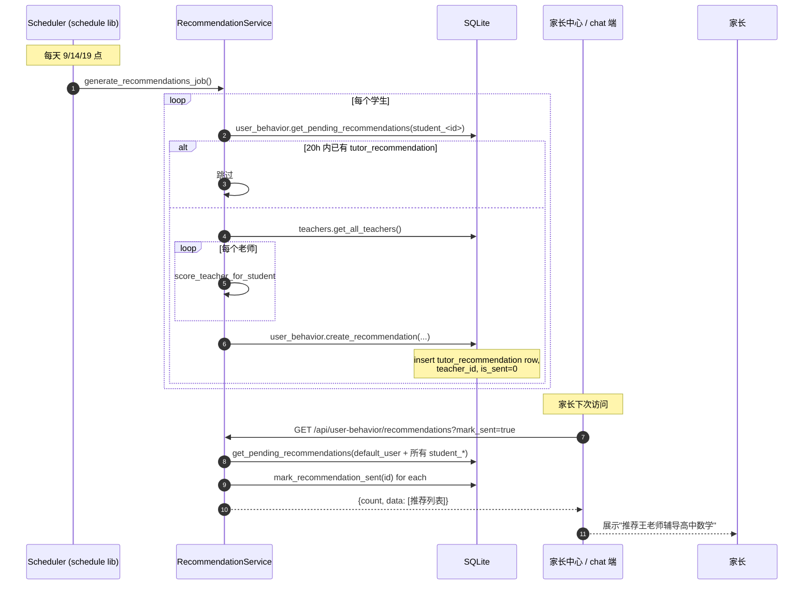
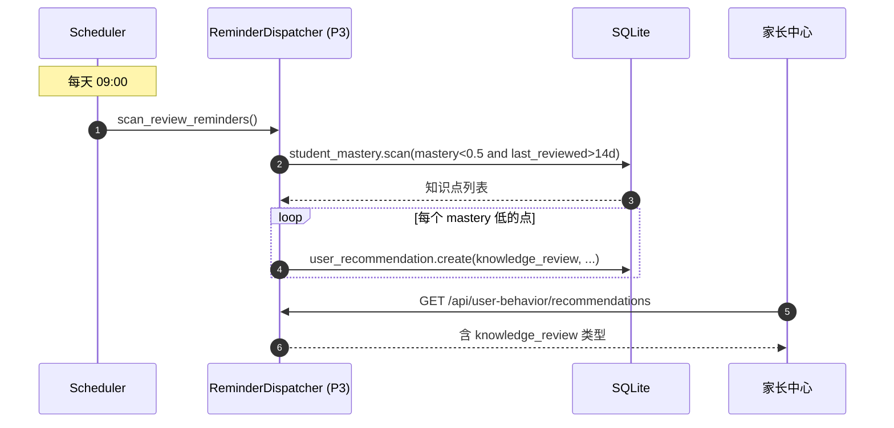

# AGENT_FLOW_DIAGRAMS

> P0 阶段产物 #5。 4 个核心 agent 流的时序图,基于 `agents/` 实际代码路径绘制。
>
> 每图都标 **LLM 调用次数** 和 **DB 写次数**,作为后续成本/性能优化基线。

## 1. 任务分类路由 (TaskClassificationAgent)

**触发**: 家长发任何消息到 `/chat/stream` 或 `/chat` 端点
**代码路径**: `api/chat_handler.ProcessUserInput_stream` → `TaskClassificationAgent.classify_task_stream` → `ClassificationProcessor.process_task_stream` → `TaskClassifier.classify` (LLM) → 根据分类结果分发给 `ConsultantAgent` / `TrialAgent` / `LessonAgent` / `UnrelatedHandler`

**LLM 调用**: 1 次 (TaskClassifier)
**DB 写**: 0 (但本轮修复后, 后台 `recommendation_service` 会独立写 `user_recommendations`, 跟本流无关)
**典型延迟**: 1-3 秒

---

## 2. 试讲多轮流程 (TrialAgent)

**触发**: `intent == "trial"` 路由过来
**代码路径**: `TrialAgent.__init__.TrialProcessor` → `TrialInputParser.parse_stream` (LLM 提取结构化 JSON) → 多轮补全信息 → `TrialTeacherFinder.find_recommended_teachers` → `TrialProcessor._create_trial` 写库 → 成功消息

**LLM 调用**: 1-3 次 (每轮追问 + 1 次确认,实际多在 2 次)
**DB 写**: 1 次 lessons + 1 次 user_behaviors (trial_book)
**典型延迟**: 5-15 秒(包含家长输入时间)

---

## 3. RAG 咨询 (ConsultantAgent)

**触发**: `intent == "consultation"` 路由过来
**代码路径**: `ConsultantAgent.consult_stream` → `ConsultationClassifier.is_consultation_related` (LLM) → `KnowledgeRetriever.search` (FAISS) → `ResponseGenerator.generate_stream` (LLM 流式)

**LLM 调用**: 2 次 (判别 + 流式回答,实际流式 1 次)
**DB 读**: 1 次 FAISS 向量搜
**典型延迟**: 2-6 秒(取决于流式返回速度)

---

## 4. 续费/流失提醒派发 (后台调度 + 家长中心)

**触发**: 后台 scheduler 每天 9:00 / 14:00 / 19:00 (或家长主动 POST `/api/user-behavior/send-reminder`)
**代码路径**: `RecommendationService.generate_recommendations_job` → 遍历 students → `recommend_teachers` → 写 `user_recommendations` (限频 20h) → 家长中心 `GET /api/user-behavior/recommendations?mark_sent=true` 拉取并标记

**LLM 调用**: 0 (推荐打分是纯 Python 算法)
**DB 写**: 1-N 次 user_recommendations (限频后通常 0-2)
**DB 读**: 1 次拉取
**典型延迟**: < 1 秒

---

## 5. (P3 规划) 复习提醒流

**未实现, P3 引入**,这里是占位:

**P3 实现细节见阶段计划 P3**。
