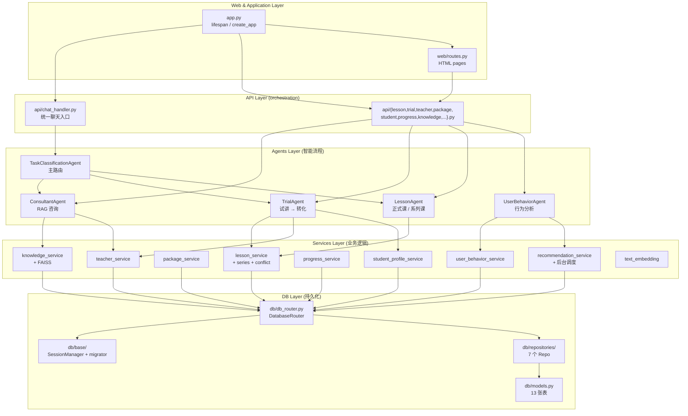
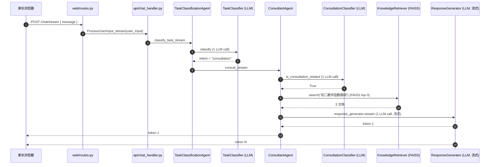

# ARCHITECTURE_MAP

> P0 阶段产物 #3。 本文件是"权威地图",后续 P1-P4 改架构前先看这里。
>
> 数据来源: `scripts/audit_repo.py` (T1 代码量 + T2 分层合规) + `agents/__init__.py` 实际注册。

## 总览

## 分层职责

### 1. Web & Application Layer

| 文件 | 职责 |
|---|---|
| `app.py` | FastAPI lifespan + create_app + 挂中间件 + 注册路由;启动时种 8 老师/3 套餐/默认学生 + 起后台推荐调度器 |
| `web/routes.py` | 10 个 HTML 页面路由(`/`, `/teachers`, `/packages`, `/schedule-calendar` 等) |

### 2. API Layer (orchestration)

**核心入口**: `api/chat_handler.py` 的 `ProcessUserInput_stream` 是整个聊天流的统一入口,被 `web/routes.py: /chat/stream` 调用。

| 文件 | 职责 |
|---|---|
| `chat_handler.py` | 任务分类 Agent 的入口,支持按 `session_id` 隔离(本轮修复) |
| `task.py` | 任务分类 REST 端点 |
| `knowledge.py` | 知识库管理 (CRUD) |
| `teacher.py` | 老师库 CRUD |
| `lesson.py` | 单次课 + 系列课 + 调课 + 退课 + 冲突预览 |
| `trial.py` | 试讲预约 + 反馈 + 转正式课 + 推荐套餐 |
| `student.py` | 学员档案 CRUD |
| `package.py` | 套餐 CRUD + 购买(MVP mock) |
| `progress.py` | 课后进度记录 |
| `user_behavior_analysis.py` | 家长偏好 + 推荐拉取 + 提醒 |

### 3. Agents Layer (智能流程)

**主入口**: `agents/task_classification_agent.py` 的 `TaskClassificationAgent` 是路由中枢,所有家长输入先到这里。

| 模块 | 职责 |
|---|---|
| `task_classification_agent.py` | 主控制器,持有 3 个子 agent + StateManager |
| `task_classification/` | 5 文件: `TaskClassifier` (LLM 一次分类) / `StateManager` / `AgentRouter` / `ClassificationProcessor` / `UnrelatedHandler` |
| `consultant_agent.py` + `consultant/` | RAG 咨询: `KnowledgeRetriever` (FAISS) + `ConsultationClassifier` (LLM) + `ResponseGenerator` (LLM 流式) |
| `trial/` | 试讲: `TrialInputParser` (LLM 提取结构化) + `TrialTeacherFinder` + `TrialMessageBuilder` + `TrialProcessor` + `TrialFeedbackCollector` + `ConversionLogic` |
| `lesson/` | 正式课: `ScheduleGenerator` (周固定展开) + `ConflictDetector` + `RescheduleHandler` + `CancelHandler` + `LessonProcessor` |
| `user_behavior_agent.py` + `user_behavior/` | 行为分析: `BehaviorRecorder` + `PatternAnalyzer` + `PreferenceManager` + `RenewalDetector` + `ChurnPredictor` |
| `user_behavior/reminder_dispatcher.py` | (规划中, P3 引入) |

### 4. Services Layer (业务逻辑)

| 服务 | 关键方法 | 备注 |
|---|---|---|
| `teacher_service` | CRUD + 学科年级筛选 + 默认 8 名老师种子 | 8 个老师已经在 DB |
| `lesson_service` | 单次课 + 系列课 + 冲突检测 + 调课 + 退课 | `create_lesson_series` 是核心入口 |
| `package_service` | CRUD + 购买(mock) + 3 个默认套餐种子 | |
| `student_profile_service` | 学生 + 家长 CRUD + 默认家长/学生种子 | |
| `progress_service` | 课后进度 CRUD | |
| `knowledge_service` | RAG 检索 + FAISS 索引管理 + 增量化(本轮修复) | `search` 是热路径 |
| `recommendation_service` | 老师打分 + 后台调度 + 推荐落库(本轮修复) | 每天 9/14/19 点 |
| `user_behavior_service` | 行为记录 + 偏好 + 模式分析 | 80% 接口通过 `UserBehaviorAgent` 间接调用 |
| `text_embedding` | Embedding 模型工厂 + 向量查找 | 接 `config.model_provider` |

### 5. DB Layer (持久化)

| 组件 | 职责 |
|---|---|
| `db/db_router.py` | `DatabaseRouter`: 7 个 Repository 聚合入口 |
| `db/models.py` | 13 张表 (Base + 枚举 + 模型) |
| `db/base/session_manager.py` | scoped_session + 启动时跑 migrator |
| `db/base/schema_migrator.py` | 轻量级 SQLite 迁移(加列 + 加表,本轮扩展支持 user_recommendations 列) |
| `db/repositories/` | 7 个 Repository (每个负责一领域 CRUD) |
| `db/base/interfaces.py` | Repository 抽象基类 (但目前实际未启用,见 IMPLEMENTATION_STATUS.md) |

## 跨层调用图:一次家长问"初二数学函数基础不好怎么办"

**LLM 调用次数**: 3 次 (分类 / 咨询判别 / 流式回答)
**DB 写次数**: 0 (只读)
**总延迟**: 取决于 3 次 LLM 延迟, 通常 3-8 秒

## 分层合规状态(来自 audit T2)

| 违规 | 文件 | 原因 | 修复 |
|---|---|---|---|
| 1 | `services/lesson_service.py:161` | 在 `create_lesson_series` 函数体内 `from agents.lesson import ScheduleGenerator, ConflictDetector` (lazy import) | 应在 `agents/lesson/__init__.py` 暴露组合函数,或 `services/lesson_service.py` 通过依赖注入拿 ScheduleGenerator。 **P0 不修,留作 P3 或 P4 改进** |

**其它已知限制** (T3 死代码候选 / T4 未用 import) 见 `docs/REPO_HEALTH.md`。

## 调用约定

- **API 层不持有状态** (除 session_id 维度的 StateManager)
- **Agent 层不直接读写 DB** — 通过 Service 层
- **Service 层不调 LLM** — LLM 调用是 Agent 层职责
- **DB 层不调上任何层** — 最底层

违反任意一条,本表会变红。
