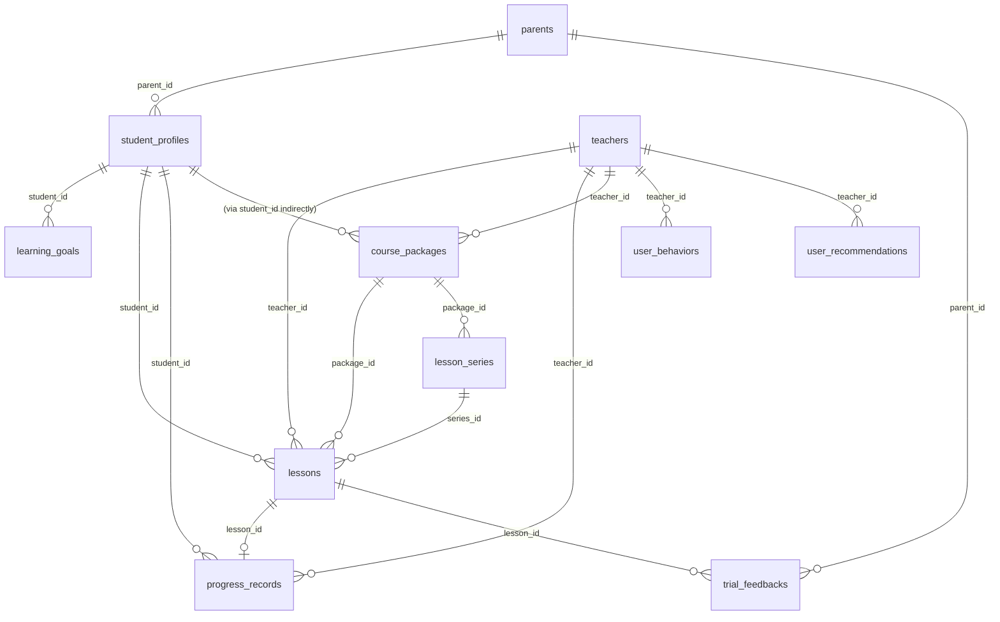

# DATA_DICTIONARY

> P0 阶段产物 #4。 13 张表的权威字段定义。
>
> 字段顺序、类型、默认值与 `db/models.py` 完全一致。 谁读谁写基于代码扫描,可能有遗漏,以实际 import 为准。

## 表关系总览

## 13 张表

### 1. `parents` — 家长

| 列                 | 类型       | 约束/默认            | 备注                    |
| ----------------- | -------- | ---------------- | --------------------- |
| id                | Integer  | PK               |                       |
| name              | String   | NOT NULL         |                       |
| phone             | String   | UNIQUE, nullable |                       |
| budget_max        | Float    | nullable         | 单课时预算上限(老师推荐打分用,目前未接) |
| preferred_contact | String   | default "wechat" |                       |
| created_at        | DateTime | default now      |                       |

**写**: `StudentProfileService.get_or_create_default_parent` / `add_parent`
**读**: `StudentProfileService.get_parent` / `get_students_by_parent`
**当前数据**: 1 个 default parent(无 phone, budget_max 未设)

### 2. `student_profiles` — 学员档案

| 列                | 类型       | 约束/默认                  | 备注                         |
| ---------------- | -------- | ---------------------- | -------------------------- |
| id               | Integer  | PK                     |                            |
| parent_id        | Integer  | FK parents.id          |                            |
| name             | String   | NOT NULL               |                            |
| grade_level      | String   | 枚举: 小学低年级/小学高年级/初中/高中  |                            |
| weak_subjects    | JSON     | nullable               | 薄弱学科 list[str]             |
| learning_goals   | JSON     | nullable               | 学习目标 list[str]             |
| preferred_style  | String   | 枚举: 严格/温和/启发式/高压       | 老师推荐打分用                    |
| school           | String   | nullable               |                            |
| notes            | Text     | nullable               | 流失原因等                      |
| engagement_score | Float    | default 0.5            | 0-1, 由 trial_feedback 提升/调 |
| churn_risk       | Float    | default 0.0            | 0-1, 由 ChurnPredictor 写    |
| upsell_signal    | String   | default "none"         | strong/weak/none           |
| created_at       | DateTime | default now            |                            |
| updated_at       | DateTime | default now + onupdate |                            |

**写**: `StudentProfileService` 全套; `ChurnPredictor.predict_churn_risk` 写 churn_risk
**读**: 几乎所有 service 都会读
**当前数据**: 1 个默认学生 "小明" + 25 个 demo 学生(都是 "演示-小明")

### 3. `teachers` — 老师

| 列                | 类型       | 约束/默认         | 备注                                |
| ---------------- | -------- | ------------- | --------------------------------- |
| id               | Integer  | PK            |                                   |
| name             | String   | NOT NULL      |                                   |
| avatar_url       | String   | nullable      |                                   |
| gender           | String   | nullable      | 男/女                               |
| subjects         | JSON     | 学科 list[str]  | SubjectEnum                       |
| grade_levels     | JSON     | 年级段 list[str] |                                   |
| teaching_style   | String   | 枚举            |                                   |
| education_bg     | String   | nullable      |                                   |
| years_experience | Integer  | default 0     |                                   |
| hourly_rate      | Float    | default 200.0 |                                   |
| rating           | Float    | default 5.0   | 0-5? 实际数据 4.7-4.9                 |
| availability     | JSON     | nullable      | `[{day, slots: ["19:00-20:00"]}]` |
| is_active        | Boolean  | default True  |                                   |
| trial_available  | Boolean  | default True  |                                   |
| bio              | Text     | nullable      |                                   |
| highlights       | JSON     | nullable      | 标签 list[str]                      |
| created_at       | DateTime | default now   |                                   |

**写**: `TeacherService` CRUD
**读**: `RecommendationService.score_teacher_for_student`, `TrialTeacherFinder`, 所有老师页
**当前数据**: 8 个

### 4. `course_packages` — 课时套餐

| 列                | 类型       | 约束/默认          | 备注                            |
| ---------------- | -------- | -------------- | ----------------------------- |
| id               | Integer  | PK             |                               |
| name             | String   | NOT NULL       |                               |
| teacher_id       | Integer  | FK teachers.id |                               |
| subject          | String   |                |                               |
| grade_level      | String   |                |                               |
| total_lessons    | Integer  |                |                               |
| duration_minutes | Integer  | default 60     |                               |
| price_total      | Float    |                |                               |
| price_per_lesson | Float    |                |                               |
| weekly_schedule  | JSON     |                | `[{day_of_week, start_time}]` |
| validity_days    | Integer  | default 180    |                               |
| description      | Text     | nullable       |                               |
| is_active        | Boolean  | default True   |                               |
| created_at       | DateTime | default now    |                               |

**写**: `PackageService` CRUD
**读**: 套餐页 + `ConversionLogic.recommend_packages` + `ScheduleGenerator`
**当前数据**: 3 个默认 (高一数学 / 高三物理 / 初中英语)

### 5. `lesson_series` — 周固定系列课

| 列 | 类型 | 约束/默认 | 备注 |
|---|---|---|---|
| id | Integer | PK | |
| teacher_id | Integer | FK teachers.id | |
| student_id | Integer | FK student_profiles.id | |
| package_id | Integer | FK course_packages.id, nullable | |
| start_date | Date | | |
| end_date | Date | | |
| weekly_pattern | JSON | | |
| total_lessons | Integer | | |
| completed_lessons | Integer | default 0 | **手动写** (需 P3 改进) |
| cancelled_lessons | Integer | default 0 | **手动写** |
| status | String | default "active" | active/paused/ended |
| created_at | DateTime | default now | |

**写**: `trial.py /convert` 创建, `LessonService.cancel_series/pause_series/resume_series` 改
**读**: `series_router.get_series_detail` + 系列课页

### 6. `lessons` — 单次/系列内具体一节

| 列                  | 类型       | 约束/默认                           | 备注                                                                   |
| ------------------ | -------- | ------------------------------- | -------------------------------------------------------------------- |
| id                 | Integer  | PK                              |                                                                      |
| teacher_id         | Integer  | FK teachers.id                  |                                                                      |
| student_id         | Integer  | FK student_profiles.id          |                                                                      |
| package_id         | Integer  | FK course_packages.id, nullable |                                                                      |
| series_id          | Integer  | FK lesson_series.id, nullable   |                                                                      |
| lesson_type        | String   | trial/regular/series/makeup     | LessonTypeEnum                                                       |
| subject            | String   |                                 | SubjectEnum                                                          |
| scheduled_at       | DateTime | NOT NULL                        |                                                                      |
| duration_minutes   | Integer  | default 60                      |                                                                      |
| status             | String   |                                 | LessonStatusEnum (pending/confirmed/completed/cancelled/rescheduled) |
| series_index       | Integer  | nullable                        | 系列内第几节,从 1 开始                                                        |
| progress_record_id | Integer  | nullable                        | **软引用**,不建 FK                                                        |
| parent_feedback    | Text     | nullable                        |                                                                      |
| price              | Float    | nullable                        |                                                                      |
| created_at         | DateTime | default now                     |                                                                      |
| updated_at         | DateTime | default now + onupdate          |                                                                      |

**写**: `LessonService.create_lesson` / `complete_lesson` / `cancel_lesson` / `reschedule_lesson` / `trial.py /book`
**读**: 所有 lesson API

### 7. `progress_records` — 课后进度

| 列               | 类型       | 约束/默认                  | 备注                                              |
| --------------- | -------- | ---------------------- | ----------------------------------------------- |
| id              | Integer  | PK                     |                                                 |
| lesson_id       | Integer  | FK lessons.id          |                                                 |
| student_id      | Integer  | FK student_profiles.id |                                                 |
| teacher_id      | Integer  | FK teachers.id         |                                                 |
| content_covered | Text     |                        | 本次课内容                                           |
| mastery_score   | Float    |                        | 0-10                                            |
| homework        | Text     | nullable               | 作业                                              |
| weak_points     | JSON     | nullable               | 暴露的薄弱点 list[str], **P1+ 将驱动 StudentMastery 写入** |
| ai_summary      | Text     | nullable               | AI 课堂小结                                         |
| teacher_comment | Text     | nullable               |                                                 |
| parent_comment  | Text     | nullable               |                                                 |
| created_at      | DateTime | default now            |                                                 |

**写**: `ProgressService.add_progress` (课后)
**读**: `ChurnPredictor._homework_completion_rate` (基于 `homework` 字段), `student_profile.html` 展示

### 8. `trial_feedbacks` — 试讲反馈

| 列                    | 类型       | 约束/默认         | 备注        |
| -------------------- | -------- | ------------- | --------- |
| id                   | Integer  | PK            |           |
| lesson_id            | Integer  | FK lessons.id |           |
| parent_id            | Integer  | FK parents.id |           |
| rating               | Integer  | 1-5           |           |
| would_continue       | Boolean  |               |           |
| feedback_text        | Text     | nullable      |           |
| recommended_subjects | JSON     | nullable      | list[str] |
| created_at           | DateTime | default now   |           |

**写**: `TrialFeedbackCollector.submit_feedback`
**读**: `ConversionLogic.recommend_packages`, `StudentProfileService.update_engagement` (通过 trial_feedback 触发)

### 9. `learning_goals` — 学习目标

| 列 | 类型 | 约束/默认 | 备注 |
|---|---|---|---|
| id | Integer | PK | |
| student_id | Integer | FK student_profiles.id | |
| subject | String | | |
| target_score | Float | nullable | 目标分数(高考/中考) |
| deadline | Date | nullable | |
| description | Text | | |
| status | String | default "active" | active/achieved/abandoned |
| created_at | DateTime | default now | |

**写**: `StudentProfileService.add_learning_goal`
**读**: 学员画像展示
**当前数据**: 0 (未使用过)

### 10. `knowledge_documents` — 知识库文档 (RAG)

| 列 | 类型 | 约束/默认 | 备注 |
|---|---|---|---|
| id | Integer | PK | |
| content | Text | NOT NULL | |
| category | String | NOT NULL | course_intro/subject_method/teacher_intro/exam_strategy/parent_guide/faq |
| keywords | JSON | nullable | list[str] |
| embedding | JSON | nullable | **存为 list[float]**, **不是 pgvector,SQLite JSON** |
| created_at | DateTime | default now | |
| updated_at | DateTime | default now + onupdate | |
| is_active | Integer | default 1 | 软删除标志 (0=删, 1=活) |

**写**: `KnowledgeService.add_document/update_document/delete_document`
**读**: `KnowledgeService.search` (FAISS top-k + 二次过滤)
**当前数据**: 5 条默认

### 11. `user_behaviors` — 用户行为埋点

| 列 | 类型 | 约束/默认 | 备注 |
|---|---|---|---|
| id | Integer | PK | |
| user_id | String | NOT NULL, default "default_user" | **当前全部 default_user**,未接家长账号 |
| action_type | String | NOT NULL | trial_book / trial_feedback / trial_convert / lesson / consultation 等 |
| action_data | JSON | nullable | 自由 dict |
| teacher_id | Integer | FK teachers.id, nullable | 本轮迁移加的列 |
| session_id | String | nullable | |
| created_at | DateTime | default now | |

**写**: `UserBehaviorService.record_behavior` (由 `api/trial._record_behavior_safe` 等调用)
**读**: `PatternAnalyzer.analyze_user_preferences`

### 12. `user_preferences` — 用户偏好

| 列 | 类型 | 约束/默认 | 备注 |
|---|---|---|---|
| id | Integer | PK | |
| user_id | String | NOT NULL, default "default_user" | |
| preference_type | String | NOT NULL | teacher / time_period / duration / subject / teaching_style |
| preference_value | String | NOT NULL | |
| confidence_score | Integer | default 1 | |
| last_updated | DateTime | default now + onupdate | |

**写**: `PreferenceManager.update_xxx_preference`
**读**: `UserBehaviorAgent.generate_personalized_reminder`
**当前数据**: 0 (未填充)

### 13. `user_recommendations` — 推荐队列

| 列                   | 类型       | 约束/默认                            | 备注                                              |
| ------------------- | -------- | -------------------------------- | ----------------------------------------------- |
| id                  | Integer  | PK                               |                                                 |
| user_id             | String   | NOT NULL, default "default_user" | 本轮用 `student_<id>` 区分                           |
| recommendation_type | String   | NOT NULL                         | tutor_recommendation / knowledge_review (P3 引入) |
| content             | Text     | NOT NULL                         | 推荐描述                                            |
| teacher_id          | Integer  | FK teachers.id, nullable         | 本轮迁移加的列                                         |
| is_sent             | Integer  | default 0                        | 是否已展示给家长                                        |
| created_at          | DateTime | default now                      | 本轮迁移加的列                                         |
| sent_at             | DateTime | nullable                         | 本轮迁移加的列                                         |

**写**: `RecommendationService.generate_recommendations_job` (本轮修复后真实落库)
**读**: `GET /api/user-behavior/recommendations?mark_sent=true` (本轮新增)

## 软删除 / 枚举 / JSON 字段注意

### 软删除
- `knowledge_documents.is_active`: 0=已删, 1=活跃, 由 `KnowledgeService.delete_document(soft_delete=True)` 维护
- `user_recommendations.is_sent`: 0=未展示, 1=已展示
- 其它表**没有**软删除标志,删了就是真删

### 枚举(代码里有,库里存 str)
- `SubjectEnum`: 数学/英语/物理/化学/语文/生物/历史/地理/政治
- `GradeLevelEnum`: 小学低年级/小学高年级/初中/高中
- `TeachingStyleEnum`: 严格/温和/启发式/高压
- `LessonTypeEnum`: trial/regular/series/makeup (库里直接存字符串)
- `LessonStatusEnum`: pending/confirmed/completed/cancelled/rescheduled
- `KnowledgeCategoryEnum`: course_intro/subject_method/teacher_intro/exam_strategy/parent_guide/faq

⚠️ **存的是字符串,不是整数枚举值**,跨服务读要小心大小写一致。

### JSON 字段
- `teacher.subjects / grade_levels / availability / highlights`
- `course_package.weekly_schedule`
- `lesson_series.weekly_pattern`
- `progress_record.weak_points`
- `trial_feedback.recommended_subjects`
- `user_behavior.action_data`
- `knowledge_document.keywords / embedding`

JSON 字段查询不能用 SQL JOIN,只能 `LIKE '%xxx%'` 或全量拉回 Python 处理。

## 索引 / 性能

当前**没有显式声明的索引** (除了 PK/FK 自带),高频查询字段:
- `lessons.teacher_id + scheduled_at` (冲突检测)
- `lessons.student_id` (学员视图)
- `lessons.series_id` (系列详情)
- `user_behaviors.user_id + created_at` (PatternAnalyzer)
- `user_recommendations.user_id + is_sent` (本轮推荐的限频和拉取)

数据量小(< 10k 行)时不痛,上量后考虑加 `Index`。
